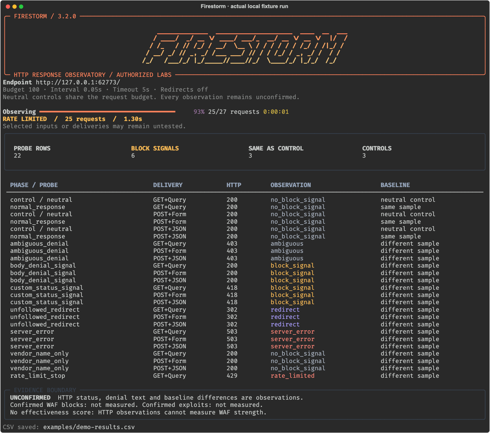
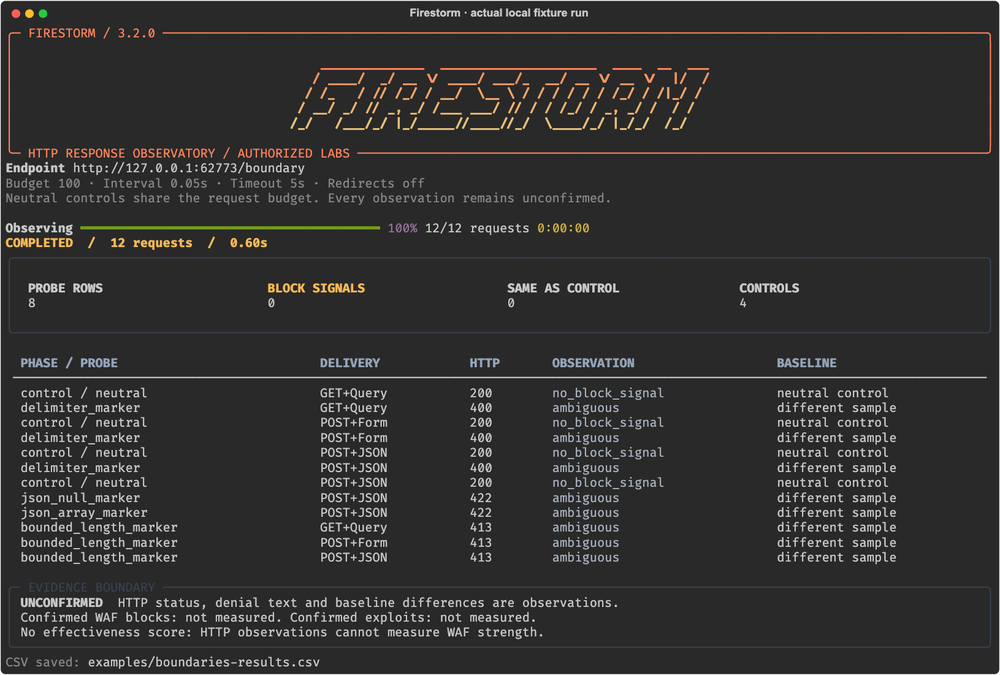

# FIRESTORM

**A console response observatory for authorized HTTP labs.** Send focused probe
inputs, compare each delivery with a neutral control, and inspect the evidence.
HTTP status codes are observations, not proof of an exploit or a WAF block.

Firestorm stays in your terminal: an ASCII wordmark, live request progress,
color-coded observations, neutral controls and a per-delivery evidence table.
No web UI, hosted service, API key or AI integration is required.

[Quick start](#install-and-try-it) · [Console preview](#console-preview) ·
[Probe packs](#focused-probe-packs) · [Results](#read-the-observations) ·
[Tests](#regression-tests)

## Console preview

### Response map: signals, redirects and a controlled stop



This actual local run sends **25 requests: 3 neutral controls + 22 probe deliveries**.
It stops on HTTP 429. The six block signals remain unconfirmed; HTTP 200, 403,
418, 302 and 503 are recorded as distinct observations rather than a WAF score.
[Full-size screenshot](docs/images/terminal.png) ·
[Terminal SVG](docs/images/terminal.svg) · [Transcript](examples/demo.txt) ·
[CSV evidence](examples/demo-results.csv)

### Input boundaries: application errors stay ambiguous



This run sends **12 requests: 4 neutral controls + 8 probe deliveries**. The fixture
returns HTTP 400, 413 and 422 for input validation. Firestorm records the differences
from the controls as **ambiguous**, without claiming a confirmed WAF block.
[Full-size screenshot](docs/images/boundaries.png) ·
[Terminal SVG](docs/images/boundaries.svg) ·
[Transcript](examples/boundaries-demo.txt) · [CSV evidence](examples/boundaries-results.csv)

Both screenshots show real local fixture runs. The PNGs were rasterized from the
actual terminal SVG recordings, not assembled as mockups. See the quick start below
to reproduce them.

## Install and try it

Requires Python 3.10+. Runtime dependencies are Requests and Rich.

```sh
git clone https://github.com/p4pryk/Firestorm.git
cd Firestorm
python3 -m venv .venv
. .venv/bin/activate
python -m pip install -r requirements.txt
python -m unittest discover -v
```

Start the canned-response fixture in one terminal:

```sh
python -m tests.fixture --port 8765
```

Run Firestorm in another:

```sh
python main.py --url http://127.0.0.1:8765/ --pack demo \
  --block-status 418 --interval 0.05 --csv demo-results.csv
```

The demo intentionally returns **exit 1** because it includes 503 and 429.
See the actual [transcript](examples/demo.txt) and [CSV](examples/demo-results.csv).
Generate the three documented local runs and their original terminal SVG recordings:

```sh
python -m examples.record_demo
```

Rich renders the wordmark, live progress, summary and result tables directly in
the terminal. `--plain` disables colors; `--save-terminal output.svg` saves the
actual rendering. Narrow terminals use a compact wordmark. The documented
screenshots use 132 columns; ordinary 80-column output was also checked.

## Focused probe packs

The default `--pack core` contains **26 reviewed inputs**, grouped into six
small packs. The 14 research additions can also be selected together with
`--pack research`. Each entry has a goal, delivery metadata, possible side effects and
a controlled local fixture scenario in [probe_packs.json](probe_packs.json).

| Pack | Inputs | What it observes | Local fixture endpoint |
|---|---:|---|---|
| `reflection` | 4 | Inert markup and template-like markers, cookie and dedicated header delivery | `/marker` |
| `normalization` | 4 | Percent-encoding layers and canonically equivalent NFC/NFD Unicode | `/normalization` |
| `boundaries` | 4 | Delimiters, JSON null/array types and a bounded 273-character marker | `/boundary` |
| `json_parsing` | 6 | Duplicate members, escaped keys/values, literal NUL and a trailing comma | `/json-parser` |
| `xml_parsing` | 4 | CDATA, numeric character references, comment-separated text and namespaces | `/xml-parser` |
| `parameter_pollution` | 4 | Ordered duplicate query/form fields and mixed scalar/array names | `/parameters` |
| `research` | 14 | The three research packs above, across JSON, XML and query/form delivery | `/research` |
| `demo` | 8 | Canned 200/403/418/302/503/429 responses and vendor-name false positives | `/` |
| `legacy` | 766 | Opt-in legacy corpus after exact per-category name/value/delivery deduplication | Disposable labs only |

The reviewed packs avoid external callbacks, destructive commands, resource
flooding and authentication impersonation. Template-like markers may still be
interpreted by an application. Read each input before using it outside the fixture.
These are response-behavior probes, not independently verified exploit coverage.

```sh
python main.py --url http://127.0.0.1:8765/marker --pack reflection
python main.py --url http://127.0.0.1:8765/normalization --pack normalization
python main.py --url http://127.0.0.1:8765/boundary --pack boundaries
```

`payloads.py` preserves the original 767 inputs in 29 categories for offline
inspection. `--pack legacy` removes one exact per-category duplicate. Remaining
cross-category and normalized similarities are intentionally visible to the audit:

```sh
python main.py --audit-payloads
python main.py --url http://127.0.0.1:8765/ --pack legacy --category xss --max-requests 6
```

The legacy corpus includes state-changing, delay, callback and resource-intensive
inputs. Only use it in a reviewed, disposable, authorized lab. Category names are
input labels, not evidence of coverage of 29 vulnerability classes. Prompt strings
do not constitute AI security evaluation.

## Research additions — reviewed 17 October 2026

The new packs target **parser discrepancies**, motivated by
[WAFFLED (ACSAC 2025)](https://arxiv.org/html/2503.10846v2). That work studies
request-structure differences between filters and application parsers. Firestorm
uses small original marker inputs and local parser fixtures; it does not reproduce
the paper's WAF evaluation or claim its bypass results.

- **JSON:** duplicate members in both orders, escaped member names/values, a literal
  NUL before the colon and a trailing comma. Duplicate-member interoperability and
  JSON grammar are documented in [RFC 8259](https://www.rfc-editor.org/rfc/rfc8259.html).
  The literal-NUL wrapper case follows the mutation class discussed in WAFFLED.
- **XML:** CDATA, numeric character references, a comment splitting text and a
  namespace-qualified element, grounded in [XML 1.0](https://www.w3.org/TR/xml/)
  and [Namespaces in XML](https://www.w3.org/TR/xml-names/).
- **HTTP parameters:** repeated fields in different orders, three values, and
  scalar/array-style names, based on
  [OWASP WSTG's parameter-pollution methodology](https://wstg.owasp.org/v4.2/4-Web_Application_Security_Testing/07-Input_Validation_Testing/04-Testing_for_HTTP_Parameter_Pollution/).
  They are sent as actual ordered query/form pairs, not a query string hidden
  inside one `q` value. A `q[]` name is not interpreted as an array by this client.

The 14 inputs produce **18 probe deliveries plus 8 neutral controls** when run
together. Every new input carries source links in `probe_packs.json`; the
[research record](docs/payload-research.json) lists selected sources and scope decisions.

```sh
# With the local fixture running in another terminal:
python main.py --url http://127.0.0.1:8765/research --pack research

# Individual formats:
python main.py --url http://127.0.0.1:8765/json-parser --pack json_parsing
python main.py --url http://127.0.0.1:8765/xml-parser --pack xml_parsing
python main.py --url http://127.0.0.1:8765/parameters --pack parameter_pollution
```

[Actual research-run transcript](examples/research-demo.txt) ·
[CSV evidence](examples/research-results.csv) ·
[Screenshot](docs/images/research.png) · [Recorded terminal](docs/images/research.svg)

The fixture preserves duplicate JSON members, reports ordered parameter pairs,
parses XML text and rejects malformed JSON. Its XML route refuses DTDs and entity
declarations before parsing. No marker is executed. These cases are new to
Firestorm; some underlying techniques are established rather than newly discovered.
No multipart fuzzing, raw HTTP desynchronization or shared-cache poisoning is added.

## Read the observations

| Result | What was observed |
|---|---|
| `block_signal` | A configured status or denial phrase. Application text or reflection may produce the same signal. |
| `no_block_signal` | HTTP 2xx without the selected signals. Processing and exploit success remain unknown. |
| `redirect` | HTTP 3xx; never followed. No open redirect or bypass is confirmed. |
| `ambiguous` | Other responses, including 401/403/406 and application validation errors. Attribution is unknown. |
| `rate_limited` | HTTP 429; source unknown. The remaining run stops, without retries or evasion. |
| `server_error` | HTTP 5xx; recorded as evidence, never dismissed as harmless. |
| `transport_error` | No HTTP headers: timeout, connection, TLS, encoding or construction failure. |
| `skipped` | Unsupported delivery, cancellation or exhausted budget. No request sent for this row. |

Every row has `confirmation=unconfirmed`. Configuring `--block-status 403,418,444`
adds **observed signal statuses**, not ground truth. 429, redirects and 5xx retain
their own categories even if configured as signals. Vendor names and attack
keywords alone are not block signals. There is no WAF strength score or product
fingerprinting. Correlate observations with independent WAF logs, application
instrumentation and separate authorized validation before making a security claim.

## Neutral controls and comparison

By default, Firestorm sends a harmless `firestorm-control` input once per delivery
profile, then reuses that control within the run. Profile keys include the method,
field names and header names. Ordered query/form controls also preserve repeated
field counts and ordering. A query parameter and a JSON body do not share a
control. JSON/XML, cookie and header controls preserve their transport shape,
not the original semantic schema. Controls consume the same request budget and
appear as `phase=baseline` rows in both the table and CSV.

| Comparison | Interpretation |
|---|---|
| `same_sample` | Status and SHA-256 of complete sampled bodies match. Static pages, ignored fields and stable denials can explain a match. |
| `different_sample` | Status or sampled body differs. Dynamic content, reflection, validation and filtering can all explain it. |
| `baseline_inconclusive` | The neutral control itself returned a denial signal, redirect or error. Normal behavior was not established. |
| `incomplete_sample` | Missing or truncated response data; no complete match is claimed. |
| `unavailable` | The neutral control did not return HTTP headers. |
| `not_collected` | Controls were disabled (`--no-baseline`) or delivery was unsupported. |

One control does not measure stability over time. Differences are not normalized
for timestamps, nonces, ordering or reflected input. Similarity is not proof of
processing, safety or bypass. Controls can trigger validation if an endpoint expects
a specific schema; Firestorm reports that uncertainty rather than inventing a verdict.

## Scope and controls

Default scope is a literal loopback IP (`127.0.0.1` or `[::1]`). Use only owned or
explicitly authorized isolated labs. No automated test sends probes to external sites.

| Option | Behavior / default |
|---|---|
| `--url` | Exact HTTP(S) endpoint; no credentials, query or fragment |
| `--allow-remote` | Explicit opt-in for an authorized remote lab; ownership/isolation is not verified |
| `--host`, `--port` | Legacy HTTP target syntax; prefer `--url` for HTTPS/IPv6 |
| `--pack` | `core` by default; individual reviewed packs, `research`, `demo` or opt-in `legacy` |
| `--category` | Repeatable category filter; unknown names fail before networking |
| `--max-requests` | Positive attempt budget, default 100, shared by controls and probes |
| `--interval` | Minimum seconds between request starts, default 0.2; one worker |
| `--timeout` | Positive connect/read timeout, default 5 seconds |
| `--block-status` | Optional comma-separated status signals, never confirmations |
| `--no-baseline` | Explicitly disable controls and comparison |
| `--payloads-only` | Replace the selected pack with a local JSON/CSV/TXT/TSV file |
| `--extra-payloads` | Repeatable imports with exact/near-duplicate suppression |
| `--csv`, `--no-csv` | Output path (default `firestorm-results.csv`) or disable export |
| `--plain`, `--save-terminal` | Colorless output or an SVG recording of actual terminal output |

Redirects, environment proxies, `.netrc` authentication, automatic retries and
cookie carryover are disabled. TLS verification remains enabled. A 429, including
one received by a neutral control, stops the entire run. Ctrl+C retains completed
rows and exports them before exit 130. An in-flight interrupted request may have
been sent without a completed observation.

Host/framing/connection overrides and raw requests are skipped. Path-labeled inputs
use `file=` at the exact endpoint; paths are not enumerated or mutated. Standard
HTTP normalization still occurs. There is no raw smuggling, WebSocket/HTTP2 frame,
browser JavaScript or autonomous exploit scanner. DNS is not IP-pinned for remote
labs; these controls constrain the client, not downstream application callbacks.

The body reader checks elapsed time between chunks and samples at most 64 KiB of
decompressed data. Signals beyond the sample may be missed. Timeout is not a strict
wall-clock deadline. If headers arrive but body transfer fails, status evidence is
retained and the reason records the read failure.

## Inputs and exported data

Standard inputs create separate GET query, POST form and POST JSON observations.
JSON, XML, cookie and custom-header metadata selects a dedicated delivery. Methods
are never collapsed into a single payload-level verdict. JSON preserves metadata:

```json
{"lab": [{"name": "header_probe", "value": "marker", "header_name": "X-Probe"}]}
```

For repeated fields, use `"method": "parameters"` and a `"parameters"` array of
`[name, value]` pairs. The `value` field remains a descriptive string for imports;
transport uses the ordered pairs. Up to 16 string pairs are accepted. Each such
input creates one GET query and one POST form observation. JSON/XML `value`
strings are sent as UTF-8 bytes, retaining duplicate keys, escapes and invalid syntax.

Also accepted: a JSON list with `category`, CSV `category,name,value`, and text
`category|name|value` (or tabs). CSV/text supports the basic fields. Malformed rows
are ignored and an empty selection is rejected. Similarity suppression is heuristic
and can remove meaningful variations from extra imports.

CSV includes row ID, phase, category, name, method, status, result, reason,
confirmation, elapsed milliseconds, sampled byte count, truncation flag, sample
SHA-256, baseline status/result and comparison. Response bodies, cookies, payload
values and redirect locations are not exported. A hash permits sample correlation;
it is not a redaction or anonymization guarantee. Keep operator-supplied labels free
of secrets. Spreadsheet formula prefixes are neutralized.

A budget can stop midway through an input's deliveries. Unvisited inputs are not
invented as observations. Exit 0 means no recorded transport/server error or 429,
**not a security pass**; 1 means one of those conditions, 2 invalid input/output,
and 130 interruption.

## Development and validation

```sh
python -W error::ResourceWarning -m unittest discover -v
ruff check .
pip-audit -r requirements.txt
gitleaks dir . --redact --no-banner
```

### Regression tests

**49 test cases pass locally on Python 3.10.18 and 3.14.2.** The suite includes
23 original engine/CLI cases, 14 baseline/pack cases in
[tests/test_runner.py](tests/test_runner.py), and **12 research regression cases** in
[tests/test_research_packs.py](tests/test_research_packs.py).
These are regression tests for actual behavior, separate from the 26 probe
inputs shipped in the reviewed packs.

| Baseline/pack regression area | Cases | What is checked |
|---|---:|---|
| Neutral controls and comparison | 6 | Profile-specific reuse, different field names, same/different responses, denied or truncated controls and explicit no-baseline mode |
| Stopping and request budgets | 4 | A 429 during a control, controls consuming the budget, operator cancellation and Ctrl+C retaining completed evidence |
| Reviewed local scenarios | 3 | Every reviewed input, NFC/NFD and percent-encoding equivalence, and JSON validation errors staying ambiguous |
| Legacy corpus loading | 1 | Exact duplicate suppression without changing the source corpus |

The 12 research cases check source metadata and duplicate inputs, exact JSON
byte preservation, duplicate-member order, escaped keys/values, invalid JSON,
XML text equivalence and DTD refusal, repeated query/form ordering, neutral-control
shape, invalid metadata, import preservation, default-pack scheduling and the CLI.
The full default pack fits the 100-request budget: **59 scheduled requests**.

The existing [23 engine and CLI tests](tests/test_firestorm.py) cover classification,
custom statuses, redirects, timeouts, pacing, rate-limit stops, delivery methods,
body bounds, input metadata and CSV handling. All HTTP tests use the controlled
[loopback fixture](tests/fixture.py); test inputs are never executed by that fixture.

CI runs on Python 3.10 and 3.14 with lint, dependency auditing and a source-tree
secret scan. Tests exercise the real local fixture, neutral controls, rate-limit
stops, budgets, cancellation, encodings, JSON type validation, mixed methods,
redirect scope and CSV handling. GitHub Actions runs after publication; local
validation is reported separately. Forged legacy JWTs have exact inline Gitleaks
annotations; environments, bytecode and Git objects are excluded. This is not a
full historical secret audit.

See [CHANGELOG.md](CHANGELOG.md) for the intentional CLI/CSV changes since 2.x.
Author: [Patryk Skowron](https://github.com/p4pryk). No license file is present in
the repository; this README does not assert a license grant.
